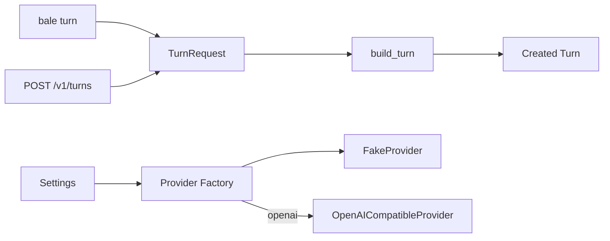
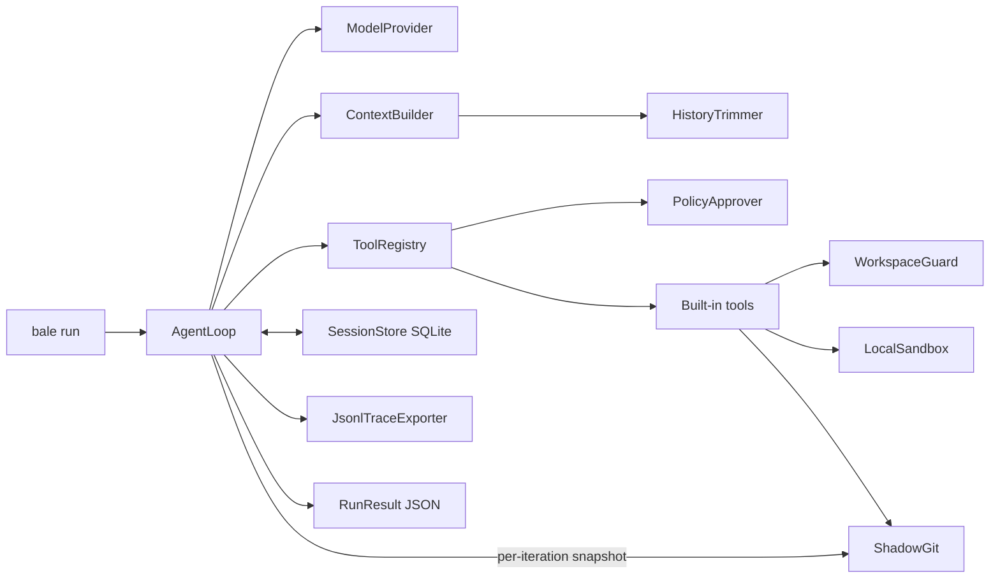
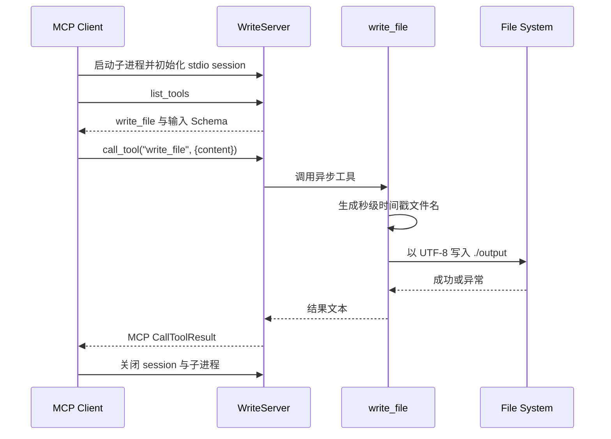
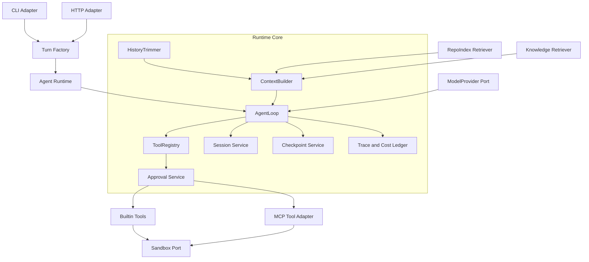

# Bale Coding Agent Harness 架构设计

## 1. 文档目的与实现状态

本文同时记录两类内容：

- **当前实现**：B0 工程骨架、Turn/ToolResult 契约、Settings、ModelProvider/FakeProvider、共享 Turn 构造入口；B1 只读 ReAct 运行时（AgentLoop、ToolRegistry、只读内置工具、Workspace 路径防护与 `bale run` 入口）；B2a 写入运行时（`write_file`/`edit_file`/`shell`/`run_tests`/`git_diff`/`finish`、LocalSandbox、审批策略、ShadowGit 快照与调用幂等）；B3 上下文与会话运行时（Token 与 wall-clock 预算、历史裁剪、稳定系统前缀、SQLite Session、`after_turn` 记忆、取消与恢复）；B4 追踪与成本运行时（JSONL Trace、耗时与可选成本估算）；B5 运行报告（Session/Trace 到 Markdown）；B6 本地闭环增强（持久化 Checkpoint 与 `bale undo`、`bale session`/`bale trace` 检查命令、`bale chat` 多轮交互、`move_file`/`delete_file`/`apply_patch`、OpenAI 兼容 Provider、`py.typed`）；B7 HTTP 执行与 SSE（`POST /v1/runs`、`POST /v1/runs/stream`），并补齐 `/health`、可选 Bearer 认证、`run_id` 指定与协作式取消；B8 检索与评测（AST/行窗口 BM25、OpenAI 兼容向量召回与混合排序、基于文件签名的增量索引与 JSON 快照、`bale search`、`bale eval`）；B9 stdio MCP 工具适配，并在 `bale chat` 与 HTTP lifespan 内复用会话，`Bm25Retriever` 在每次 Turn 自动注入检索证据；以及可独立运行的 FastMCP 文件写入示例；B10 HTTP 生产化（多 Key principal/scope、内存限流、SQLite Session 复用、HTTP 审批、JSONL 审计、Markdown 报告端点）与 Docker 执行沙箱。
- **目标架构**：Coding Agent Harness 的后续设计方向，用于约束模块边界和扩展方式。

除特别注明外，带有“规划”“目标”或“后续”标识的模块均未在当前仓库实现。文档中的目标接口是逻辑契约，不代表已有 Python 类或稳定 API。

## 2. 设计目标与边界

### 2.1 目标

目标运行时围绕以下闭环组织：

```text
理解仓库 → 构建上下文 → 模型决策 → 受控工具调用 → 修改与验证
→ 有预算地诊断重试 → 输出差异、测试和追踪证据 → 支持中断恢复
```

核心原则：

1. CLI 和 HTTP 等入口只创建统一任务，不分别实现 Agent 逻辑。
2. Agent Loop、工具治理、上下文和 Checkpoint 由项目自身维护。
3. 内置工具与 MCP 工具经过同一注册、校验、审批和超时流程。
4. 不可信代码、Shell 和测试只能在明确的执行边界中运行。
5. 检索只提供证据，不代替 Agent 完成推理与验证。
6. 每次执行都应有预算、状态、错误和可追踪结果。

### 2.2 当前非目标

当前实现不提供多模型路由、多智能体调度、Web 前端或生产级多副本隔离；HTTP 已有单进程内的认证、限流、Session、审批与审计。B1 已提供只读 Turn 执行，B2a 已提供受审的本地写入与命令执行，B3 提供基于 SQLite 的本地 Session/Resume，B4 提供本地 JSONL Trace 与按配置费率的成本估算，B6 提供 OpenAI 兼容 Provider（OpenAI/DeepSeek/Ollama）、持久化 Checkpoint 与多轮 CLI。后续实现也应避免在缺少证据时将上述未实现能力视为已经具备。`LocalSandbox` 只是受控开发环境的防护层，不是不可信代码的安全边界。

## 3. 当前实现架构

### 3.1 B0 核心契约与入口



| 当前模块 | 职责 | 边界 |
|---|---|---|
| `contracts.py` | 定义 Turn、ToolResult、审批模式和状态类型 | 只校验数据，不调度执行 |
| `settings.py` | 读取 `BALE_` 配置、保护 Secret、校验 OpenAI Key；本地回环端点可免 Key | 不打印配置或密钥 |
| `providers.py` | 定义最小 ModelProvider、FakeProvider 和工厂 | 工厂只做选择与装配 |
| `providers_openai.py` | OpenAI 兼容 Chat Completions：消息/工具编码、响应解析、429/5xx 退避、错误脱敏 | 非流式，仅标准库 `urllib` |
| `turns.py` | 校验入口输入并统一构造 `created` Turn | 不创建 workspace，不执行 Turn |
| `cli.py` | 将命令行参数转换为 TurnRequest 并输出 JSON | 初始化配置和 Provider，但不调用 `complete()` |
| `http.py` | 应用工厂：`/health`、`POST /v1/turns`、`POST /v1/runs`、`POST /v1/runs/stream`、审批查询/决定、`POST /v1/runs/{run_id}/cancel`、`GET /v1/runs/{run_id}/report` | 需要 `http_support.py` 提供认证、限流、Session 门禁、审批 Broker 与审计；报告端点还要求 Session 持久化与同一 principal |
| `http_support.py` | HTTP 调用方身份（principal/scope）、内存令牌桶、SQLite Session 并发门禁、审批 Future 与 JSONL 审计 | 全部为进程内状态，不跨副本共享 |

CLI 和 HTTP 对相同输入生成相同的非 ID 字段；`turn_id` 和 `session_id` 分别随机生成。HTTP 环境在调用 `create_app()` 时加载，导入模块本身不读取环境。

### 3.2 B1 只读、B2a 写入、B3 上下文/会话与 B4 追踪/成本运行时

B1 实现了最小 ReAct 闭环：模型请求工具调用 → 注册表治理执行 → 结果回注上下文 → 无工具调用时结束。B2a 在同一注册表上加入写入与执行工具：调用先经审批，`shell`/`run_tests` 交由 `LocalSandbox` 执行，每次迭代结束由 `ShadowGit` 在独立 git-dir 中快照，最终把 Diff 写入结果。B3 在循环外补充上下文与状态：每次模型调用前由 `ContextBuilder` 用稳定系统前缀、Session 记忆和裁剪后的历史重建提示；可选 `SessionStore` 以 SQLite 追加保存消息、Turn 状态、已执行调用和 `after_turn` 记忆，取消或中断后可按 Turn 恢复且不重复副作用。B4 在循环内埋点：`JsonlTraceExporter` 追加记录 `turn_started`、`model_call`、`tool_call`、`checkpoint` 与 `turn_finished`，`CostRates` 在配置费率后给出估算成本；追踪是 best-effort，写入失败不会改变 Turn 结果。B5 在循环外做只读投影：`build_report` 汇总 Session 中的 Turn、已执行调用、记忆与 Trace，生成 Markdown 报告，不调用模型、不写入 Session。B6 补全本地闭环：`--session-db`/`--checkpoint-dir` 让 ShadowGit git-dir 跨进程保留，复用已有 `HEAD` 作为基线，`bale undo` 按基线或指定快照恢复工作区；`bale session list/show` 与 `bale trace` 只读检查状态，`bale chat` 在单 Session 上循环 Turn；`providers_openai.OpenAICompatibleProvider` 以标准库 `urllib` 接入 OpenAI/DeepSeek/Ollama。B7 补齐 HTTP 执行：`POST /v1/runs` 同步执行并返回 `RunResult`，`POST /v1/runs/stream` 复用 Trace 事件，通过内存队列转成 SSE，最终发送 `result`；HTTP 路径不接 Session，默认无审批器（写入被拒绝），仅在 `approve_writes=true` 时使用 `auto_approve`。HTTP 生产化补充：`GET /health` 公开，配置 `BALE_HTTP_API_KEY` 后所有 `/v1` 路由要求 `Authorization: Bearer`；调用方可自带 `run_id`，运行中的 Turn 通过 `POST /v1/runs/{run_id}/cancel` 在下一个迭代边界协作取消；配置 `BALE_HTTP_SESSION_DB` 后，`GET /v1/runs/{run_id}/report` 用 `build_report` 把该 Run 所属 Session 渲染为 Markdown，按 `session_id` 过滤 Trace，并限制为同一 `principal` 访问。B8 让 `repo_index.chunk_source` 优先按 Python 顶层定义切块，`Bm25Retriever` 在每次 Turn 开始按用户消息检索并格式化片段，经 `ContextBuilder` 作为独立的 untrusted 段落写入稳定系统前缀；检索异常时跳过上下文，不改变 Turn 结果。配置 `BALE_EMBEDDING_MODEL` 后，`HybridIndex` 额外通过 OpenAI 兼容 `/embeddings` 端点向量化片段，按 `BALE_RETRIEVAL_ALPHA` 融合 BM25 与余弦相似度；embedding 不可用或返回异常时自动退回纯 BM25。索引可按文件 `mtime_ns:size` 签名增量重建，并在设置 `BALE_RETRIEVAL_INDEX_PATH` 时写入 JSON 快照供后续进程复用。B9 让 `bale chat` 在整个 REPL 期间持有同一个 MCP 会话，HTTP 应用则在 lifespan 中启动并在关闭时回收 MCP 子进程。



审批语义：`auto_read` 只读放行、写/执行拒绝；`approve_write` 只读放行、写/执行需审批；`approve_all` 全部需审批。没有审批人时写/执行一律 `denied`，拒绝结果会回注模型而不是终止循环。写/执行工具的 `call_id` 幂等缓存按 `(call_id, name, 参数指纹)` 命中；B3 恢复时只播种当前 Turn 已提交的结果，避免跨 Turn 误用缓存。

| 当前模块 | 职责 | 边界 |
|---|---|---|
| `agent/messages.py` | 运行时消息、工具调用、模型响应、用量、ToolSpec、`CachedResult` 与参数指纹 | 仅描述数据，不执行 |
| `agent/security.py` | `WorkspaceGuard`：路径规范化、`..` 逃逸与符号链接逃逸防护 | 只读，不创建工作区 |
| `agent/tools/registry.py` | `Tool` 协议与 `ToolRegistry`：注册、参数校验、审批、调用幂等、超时、错误归一化、只读并发、持久化结果播种 | 写/执行工具无审批人时一律拒绝 |
| `agent/tools/builtin.py` | `read_file`、`list_files`、`search_files`，输出有界 | 全部只读且并发安全 |
| `agent/approval.py` | `PolicyApprover`：按 `auto_read`/`approve_write`/`approve_all` 判定，缺省拒绝 | 只做决策，不负责交互或持久化 |
| `agent/sandbox.py` | `Sandbox` 端口、`LocalSandbox` 与 `DockerSandbox`：本地 argv 执行，以及每命令一次性容器（无网络、只读根、资源限额、超时清理） | `LocalSandbox` 非安全边界；`DockerSandbox` 依赖宿主 Docker daemon |
| `agent/checkpoint.py` | `ShadowGit`：独立 git-dir 的基线快照、逐迭代快照、diff 与恢复；可跨进程复用；`Snapshot` 与 `list_snapshots` 只读列出提交，`remove` 删除整个 Checkpoint 目录 | 不读写用户 `.git`；列出不初始化或提交工作区 |
| `agent/tools/write.py` | `write_file`、`edit_file`、`move_file`、`delete_file`、`apply_patch`：原子写与精确匹配前置校验 | 写副作用，需审批 |
| `agent/tools/exec.py` | `shell`、`run_tests`：拒绝 shell 元字符，交由 Sandbox 执行 | 执行副作用，需审批 |
| `agent/tools/git.py` | `git_diff` 读取 ShadowGit 变更；`finish` 作为完成信号 | 均为只读 |
| `agent/history.py` | 确定性 token 估算、按 user Turn 分组裁剪、tool 输出压缩、消息配对校验 | 只做纯函数变换 |
| `agent/context.py` | `TokenBudget`、`ContextBuilder`：稳定系统前缀、记忆与检索片段注入、预算与裁剪 | 只接收已格式化片段，不主动检索 |
| `agent/session.py` | `SessionStore`：SQLite 中的 Session、Turn、消息、已执行调用与记忆；写前意图、写后收敛 | 单机本地持久化，不提供多进程协调 |
| `agent/memory.py` | `after_turn` fast curator：`Task/Outcome` 有界摘要 | 仅 completed 且 best-effort |
| `agent/trace.py` | `TraceEvent`、`TraceExporter` 协议、`JsonlTraceExporter` 与 `NullTraceExporter`：追加写、序号递增、脱敏、失败不阻断、可选按大小轮转 | 本地 JSONL，无采样或远程导出 |
| `agent/cost.py` | `CostRates` 与 `estimate_cost`：按每千 token 费率估算成本 | 不内置默认价格，结果不是 Provider 账单 |
| `agent/report.py` | `build_report`：Session、已执行调用、记忆与 Trace 汇总为 Markdown | 只读投影，不调用模型、不改 Session |
| `agent/loop.py` | ReAct 循环、终止/取消/迭代与 token 及 wall-clock 预算、上下文重建、检索注入、Session 持久化、恢复、Trace 埋点、耗时与成本与 Diff 聚合 | 无远程 Trace 导出 |
| `repo_index/index.py` | `chunk_source`：Python 顶层定义优先、行窗口回退；`Bm25Index`、`scores` 与 `SearchHit` | 纯词法基线，不读取磁盘快照 |
| `repo_index/hybrid.py` | `HybridIndex`：BM25 与向量分数归一化融合、按文件签名增量重建、可选 JSON 快照、embedding 失败降级 | 同步实现，索引构建发生在调用线程 |
| `repo_index/embedding.py` | `Embedder` 协议、`OpenAIEmbedder` 与 `create_embedder`：标准库 `urllib` 调用 OpenAI 兼容 `/embeddings` | 不引入第三方向量库；远程端点缺少 Key 时返回 `None` |
| `repo_index/store.py` | JSON 快照读写：版本校验、文件签名、片段与可选向量、原子替换 | 快照损坏时整体忽略并重建 |
| `repo_index/retriever.py` | `Bm25Retriever`：懒加载 `HybridIndex`，按 `top_k` 与字符上限生成 `path:start-end` 片段 | 同步实现，由 Loop 在线程中调用 |
| `cli.py` `run` / `report` / `chat` / `session` / `trace` / `undo` / `checkpoint` | `run` 执行 Turn，支持 Session/Resume/Trace；`report` 输出 Markdown；`chat` 循环 Turn；`session`/`trace`/`checkpoint list` 只读检查；`undo` 从 Checkpoint 恢复；`checkpoint clean` 删除快照目录 | 退出码：`completed` 为 0，否则为 1 |

`ModelProvider.complete` 已演进为接收消息列表与工具定义、返回结构化 `ModelResponse`；`FakeProvider` 支持脚本化响应队列，使循环测试完全离线且确定；`OpenAICompatibleProvider` 面向任意 OpenAI 兼容端点，测试通过注入 transport 完成，不访问网络。

### 3.3 MCP 分层视图


| 层 | 当前组件 | 职责 |
|---|---|---|
| 协议入口 | `FastMCP("WriteServer")` | 注册工具并通过 `stdio` 接收 MCP 请求 |
| 工具层 | `write_file` | 接收字符串、生成文件名、执行写入并返回文本 |
| 文件适配 | `os`、`open` | 创建输出目录并以 UTF-8 写入 |
| 运行环境 | Python 进程 | 提供当前工作目录、系统时间和文件系统权限 |

核心契约位于 `src/bale_harness/`，MCP 示例保持在 `examples/` 且不与运行时模块共享全局配置。当前没有应用执行层或持久化层。

### 3.4 MCP 模块职责

实现位于 `examples/mcp/write_server.py`：

| 组件 | 行为 | 边界 |
|---|---|---|
| `mcp` | FastMCP 服务实例 | 当前只注册一个工具 |
| `OUTPUT_DIR` | 固定为 `./output` | 相对于启动进程的工作目录 |
| `write_file(content)` | 异步 MCP 工具 | 不支持调用方指定路径 |
| 时间戳命名 | `note_YYYYMMDD_HHMMSS.txt` | 秒级精度，可能发生同秒覆盖 |
| 错误处理 | 捕获文件操作异常并返回文本 | 尚未归一化为结构化错误 |

### 3.5 MCP 数据流



`stdio` 同时承载协议消息，因此服务代码不应向标准输出写入普通日志。客户端应负责关闭会话并回收子进程。

B9 的客户端实现位于 `agent/tools/mcp.py`：`mcp_tools(configs)` 是异步上下文管理器，负责启动服务、初始化 session、分页拉取工具，并在退出时按逆序关闭；每个工具以 `mcp_<server>_<tool>` 注册到同一个 ToolRegistry。工具默认按写副作用审批，只有配置 `read_only=true` 的服务器才作为只读工具参与并行执行；协议异常映射为 `mcp_error`，工具返回 `isError` 映射为 `mcp_tool_error`。接入面包括 `bale run --mcp-config`（单次运行）、`bale chat --mcp-config`（REPL 全程复用会话）和 HTTP `BALE_MCP_CONFIG`（应用 lifespan 内复用，启动失败即拒绝启动）。

## 4. 目标系统分层架构

当前已实现 CLI/HTTP 到 Turn 的构造路径，以及图中的 AgentLoop、ContextBuilder、HistoryTrimmer、ToolRegistry、Approval、Session 与 Checkpoint 的本地版本，并已有本地 JSONL Trace、成本估算、只读 Markdown 报告（CLI 与 HTTP 报告端点）、BM25/向量混合检索与增量索引、评测 harness、stdio/HTTP/SSE MCP Tool Adapter、HTTP Bearer 认证与运行取消、HTTP 审批/限流/审计与 Docker Sandbox，以及按 Turn 的检索注入。知识库 Retriever 与多副本共享状态仍为后续设计，不是当前目录结构或已有能力。



| 层 | 目标职责 | 关键约束 |
|---|---|---|
| 入口适配层 | CLI、HTTP、取消和审批请求 | 入口极薄，共享同一 Turn 契约 |
| Runtime 层 | Loop、预算、状态、恢复 | 不依赖具体模型、工具或 Web 框架 |
| 上下文层 | 历史、检索、工具输出和 Token 预算 | 当前用户消息最后，数据与指令分离 |
| 工具治理层 | 注册、Schema、权限、审批、超时、错误归一化 | 所有副作用工具必须经过 Registry |
| 执行适配层 | Local、Docker 或远程 Sandbox | 隔离失败时不得静默降级到宿主执行 |
| 检索适配层 | RepoIndex 与外部知识库 | 统一返回 SearchHit，受上下文预算控制 |
| 状态与观测层 | Session、Checkpoint、Trace、Usage | 支持恢复、审计和成本核算 |

## 5. 目标模块划分

| 规划模块 | 核心职责 | 主要依赖方向 |
|---|---|---|
| `agent/turn.py` | 执行期恢复信息与后续状态扩展 | 当前 B0 Turn 契约 |
| `agent/loop.py` | ReAct、终止、取消、重试预算、调用 ID | Provider、Registry、Checkpoint |
| `agent/context.py` | 稳定前缀、检索装配、TokenBudget | Retriever、History |
| `agent/history.py` | 按完整 Turn 裁剪并维持消息配对 | 领域消息模型 |
| `agent/tools/registry.py` | 注册、校验、并发、超时、错误归一化 | Tool 端口、Approval、Trace |
| `agent/tools/builtin.py` | 读写、检索、测试、Diff 等内置工具 | Sandbox、Workspace |
| `agent/tools/mcp.py` | MCP list/call、命名空间和生命周期；stdio、streamable HTTP 与 SSE 连接 | MCP SDK、Registry |
| `agent/security.py` | 路径、能力、环境变量和不可信数据边界 | Workspace、Approval |
| `agent/checkpoint.py` | 独立快照、撤销、恢复和幂等 | Git、Session |
| `sandbox/` | 本地、容器和远程执行适配 | 统一 Sandbox 端口 |
| `repo_index/` | AST/行窗口 BM25、分词、检索与片段 | Retriever 端口 |
| `providers/` | 真实模型调用、结构化输出和用量 | 当前 ModelProvider 端口 |
| `server/` | HTTP Session、审批、限流和更多健康检查 | Runtime、现有 `http.py` 执行入口 |
| `tracing/` | Span、错误、Token、延迟和成本 | 无 Runtime 反向依赖 |
| `eval/` | 固定任务、确定性验证和报告；任务命令可按配置运行在 Local/Docker Sandbox | CLI、Workspace、Verifier、Sandbox |

这些路径用于说明职责边界。B1 已实现 `agent/loop.py`、`agent/context.py`（最小前缀）、`agent/tools/registry.py`、`agent/tools/builtin.py`（只读工具）和 `agent/security.py`；B2a 已实现 `agent/approval.py`、`agent/sandbox.py`（LocalSandbox）、`agent/checkpoint.py`（ShadowGit）、`agent/tools/write.py`、`agent/tools/exec.py` 与 `agent/tools/git.py`；B3 已实现 `agent/history.py`、完整的 `agent/context.py`、`agent/session.py` 与 `agent/memory.py`；B4 已实现 `agent/trace.py` 与 `agent/cost.py`；B5 已实现 `agent/report.py`；B6 已实现 `providers_openai.py`、Checkpoint 持久化/`undo`、`session`/`trace`/`chat` CLI 与扩展写入工具；B7 已实现 `http.py` 的执行、SSE、健康检查、Bearer 认证与 `run_id` 取消；B8 已实现 `repo_index/`（AST/行窗口 BM25、`HybridIndex` 向量混合与增量快照、`Bm25Retriever` 自动注入与 `search_code`/`bale search`）和 `eval/`（固定任务、确定性文件断言与 `bale eval`）；B9 已实现 `agent/tools/mcp.py`（stdio 连接、分页 `list_tools`、工具命名空间与 `call_tool` 适配，`bale run`/`bale chat`/HTTP 接入）；B10 已实现 `http_support.py`（多 Key principal/scope、内存限流、SQLite Session 门禁、HTTP 审批 Broker、JSONL 审计）、`http.py` 的 Markdown 报告端点与 `DockerSandbox`；其余模块（如 Knowledge Retriever、多副本共享状态）仍为规划，不能当作已有能力。后续实现时应以实际代码和测试为准更新本文。

## 6. 核心逻辑契约

### 6.1 Turn

| 字段组 | 当前实现 |
|---|---|
| 身份 | `turn_id`、`session_id` 为 UUID，默认分别使用 `uuid4` |
| 输入 | 非空且去除首尾空白的 `message`、`workspace: Path`、可选 `repo_revision` |
| 预算 | `max_iterations=20` 且至少为 1、`token_budget > 0`、`cost_budget=None` 且设置时非负、`time_budget=None` 且设置时为正的秒数 |
| 权限 | `auto_read`、`approve_write`、`approve_all`，默认 `approve_write` |
| 状态 | `created`、`running`、`waiting_approval`、`completed`、`failed`、`cancelled`，默认 `created` |

Turn 禁止未知字段并支持 JSON 序列化/反序列化。构造 Turn 不会创建 workspace；`time_budget` 由 `AgentLoop` 在运行期强制执行，已执行调用 ID 与恢复位置由 B3 的 `SessionStore` 持久化。

CLI 与 HTTP 通过唯一的 `build_turn()` 构造 Turn，避免入口行为不一致。审批模式和后续状态当前只是数据契约，不表示已有审批或状态机执行逻辑。

### 6.2 Tool 与 ToolResult

当前 `ToolResult` 数据契约包含：

- `call_id`、工具名称和 `success | error | timeout | denied | cancelled` 状态；
- 文本内容、可选结构化错误码和非负 `latency_ms`；
- `truncated=False` 和默认独立字典 `metadata`；
- 未知字段拒绝与 JSON 序列化/反序列化。

B1 已实现 `ToolSpec`（名称、描述、parameters、副作用类型、并发安全标志、超时）与 `ToolRegistry`，提供参数校验、超时、错误归一化和只读并发调度；B2a 增加了写入/执行工具、审批和按 `(call_id, name, 参数指纹)` 的幂等缓存；B3 增加从持久化结果播种缓存，使恢复时已提交的副作用不再执行。调度规则是：只有标记为只读且并发安全的工具可以并行执行；写入和执行工具默认串行。

### 6.3 SearchHit

检索结果统一携带内容、相似度或排序分数、来源和元数据。代码检索还应提供路径、起止行号和 revision；知识库检索可提供 chunk/document 标识。分数不能直接解释为答案置信度。

B8 的实际实现：`repo_index.SearchHit` 携带 `path`、`start_line`、`end_line`、`score` 和 `snippet`，混合索引还会填充 `lexical_score` 与 `vector_score`。Python 文件按顶层函数/类切块（含装饰器），模块头、定义间语句和尾部代码各自成块；语法错误或非 Python 文件回退到 40 行窗口（8 行重叠）。索引使用标准库 BM25（`k1=1.5`、`b=0.75`）对标识符分词结果排序；跳过隐藏目录、常见构建/缓存目录、二进制、非文本后缀和超过 256 KiB 的文件，单次最多索引 2000 个文件和 10000 个片段。`HybridIndex` 在配置 embedding 时计算片段向量与查询向量，将 BM25 分数与余弦相似度分别按最大值归一化后以 `BALE_RETRIEVAL_ALPHA` 线性融合；embedding 失败、维度不一致或返回异常时清空向量并退回 BM25，搜索不会因此失败。增量重建以文件 `mtime_ns:size` 签名判断复用，修改或新增文件重新切块并只对缺少向量的片段调用 embedding，删除文件从索引移除；设置 `BALE_RETRIEVAL_INDEX_PATH` 时快照以 JSON 原子写入磁盘，下次进程启动直接复用片段与向量。自动注入时，`Bm25Retriever` 按 `BALE_RETRIEVAL_TOP_K`（默认 5）取前若干片段，并以字符上限截断后交给 `ContextBuilder`。

## 7. 目标核心流程

### 7.1 Turn 主流程

1. 加载 Session、工作区、能力范围和预算。
2. 装配稳定系统前缀、历史、当前任务和检索证据。
3. ModelProvider 返回助手消息或工具调用。
4. Registry 完成参数校验、权限检查、审批、幂等检查和超时控制。
5. 工具结果按不可信数据包装后进入下一轮上下文。
6. 每次迭代保存状态、追踪信息和必要 Checkpoint。
7. 无工具调用时执行任务完成判定和确定性验证。
8. 返回答案、Diff、测试结果、状态和 Trace 标识。

最大迭代、预算耗尽、取消、审批超时或不可恢复错误都不是任务成功。

### 7.2 工具治理流程

```text
查找工具 → 参数转换与 Schema 校验 → Workspace/capability 检查
→ 调用 ID 幂等检查 → 按策略审批 → 选择执行适配器
→ 超时与输出限制 → 错误归一化 → Trace → ToolResult
```

任何失败都不能退化为绕过 Registry 的宿主执行。

### 7.3 上下文与恢复

目标预算公式：

```text
available_history = context_window
                  - reserved_output
                  - reserved_tools
                  - reserved_system
                  - reserved_current
```

所有扣减后预算最小为零。超预算时先压缩检索和工具输出，再裁剪历史，最后处理长期记忆；裁剪必须维持工具调用与结果配对。恢复时只注入必要恢复块，已完成的副作用调用不得重复执行。

B3 的实际实现：

- `turn.token_budget` 表示本 Turn 累计 `total_tokens` 上限；上下文窗口由 `BALE_CONTEXT_WINDOW`（默认 128000）单独控制。
- `turn.time_budget` 表示本次执行的 wall-clock 上限（秒）。Loop 在每个迭代边界检查剩余时间，并用剩余时间包裹单次模型调用；超时以 `failed` 与 `error="time budget exceeded"` 结束。工具调用仍受各自 `timeout_ms` 约束，已启动的工具不会被额外中断；恢复执行会从恢复时刻重新计算预算。
- Token 数为确定性估算：`ceil(len(text) / 3)` 加固定消息开销，不是 Provider 计费值。
- `available_history` 使用上述公式并夹到零；固定前缀与当前 Turn 仍超窗时返回失败，不发送残缺请求。
- `HistoryTrimmer` 先压缩超长 tool 输出（默认 4000 字符），再从最旧 Turn 整组丢弃，最新 Turn 始终保留。
- `ContextBuilder` 的系统前缀在 Turn 内稳定，`after_turn` 记忆只在下个 Turn 注入。
- 自动检索在 Turn 开始时执行一次：`Bm25Retriever` 按用户消息取片段，`ContextBuilder` 将其渲染为独立的 untrusted 段落；同一 Turn 的后续模型调用复用同一前缀。检索只依赖当前消息，不感知历史；字符预算、`top_k`、混合权重与索引快照由 `BALE_RETRIEVAL_*` 与 `BALE_EMBEDDING_*` 控制。
- 索引在单个检索器或工具实例内只构建一次，同一 Turn 不自动感知文件变化；需要跨进程复用或增量刷新时，设置 `BALE_RETRIEVAL_INDEX_PATH` 并在下一次进程或重建索引时读取快照。
- 恢复按 Session 中最新 `running`/`cancelled` Turn 进行，复用原始 user 消息；执行前写入 `pending` 意图，恢复时对缺失结果合成 `outcome_unknown` 而不重放。

## 8. 技术栈选型说明

### 8.1 当前实际技术栈

| 技术 | 选择原因 | 限制 |
|---|---|---|
| Python 3.11+ | 与当前包元数据和异步契约对齐 | 本地仅验证 3.11.18 |
| Pydantic v2、pydantic-settings | 严格数据校验、环境配置和 Secret 保护 | 配置加载不代表真实 Provider 可用 |
| Typer、FastAPI、Uvicorn | 共享 TurnRequest 与 build_turn | 只创建 Turn，不执行 |
| `asyncio`、Protocol | 统一最小异步 Provider 契约 | FakeProvider 不访问网络 |
| FastMCP、`mcp==1.30.0` | 用少量代码声明示例工具和 Schema | 不等同于完整 Agent 工具治理 |
| MCP `stdio` | 本地进程集成简单、无需开放端口 | 客户端必须管理进程生命周期 |
| MCP `http`/`sse` | 无需本地进程，适合远程或多客户端共享服务 | 依赖网络与远端认证；不做重连，不提供进程级隔离 |
| pytest、Ruff、pip-tools | 离线测试、静态检查和可复现安装 | 本地通过不等于远程 CI 已运行 |
| `sqlite3`（标准库） | B3 Session、消息、已执行调用与记忆持久化 | 单机文件数据库，不提供分布式协调 |
| BM25 + 可选 embedding（标准库实现） | B8 代码检索、混合排序、增量注入与 `search_code` | 向量来自 OpenAI 兼容端点；无第三方向量库，embedding 不可用时退化为纯 BM25 |
| Docker（可选） | `DockerSandbox` 为每条命令启动独立容器，提供网络、文件系统与资源隔离 | 需要宿主 Docker daemon 与预构建镜像；共享宿主内核 |
| 本地文本文件 | MCP 示例无需外部服务 | 不提供并发、权限或持久化保证 |

### 8.2 目标技术栈

| 领域 | 建议选型 | 选择理由 |
|---|---|---|
| 语言与契约 | Python 3.11+、Pydantic v2 | 类型化配置、契约和异步运行时 |
| CLI / HTTP | Typer、FastAPI | 共享 Turn，分别提供本地与服务入口 |
| 模型 | OpenAI-compatible Provider、FakeProvider | 统一接口并支持离线测试 |
| 状态 | SQLite | 轻量、可恢复、低部署成本 |
| 工具协议 | 官方 MCP Python SDK | 与当前示例保持同一生态 |
| 代码检索 | Python AST、BM25 | 结构定位和确定性对照实验 |
| 隔离执行 | DockerSandbox（已实现） | 非 root、无网、资源限额和清理；后续可补自定义 seccomp/镜像校验 |
| 观测 | JSONL Trace、Usage/Cost Ledger | 无外部依赖即可审计 |
| 测试 | pytest、pytest-asyncio、ruff | 单元、契约、集成和静态检查 |

目标选型只有在相应模块和验证落地后才成为项目实际依赖。

## 9. 扩展点设计

当前 `ModelProvider` 定义为 `async complete(messages, tools) -> ModelResponse`，FakeProvider 是支持脚本化响应队列的离线实现。以下接口方向用于降低后续实现耦合，其中 Tool 与 ModelProvider 已落地，其余不代表已经存在：

| 扩展点 | 调用方 | 实现方应提供的能力 |
|---|---|---|
| ModelProvider | AgentLoop | 消息与工具定义输入、结构化输出、Token 用量、取消 |
| Tool | ToolRegistry | Schema、副作用元数据、超时执行、结构化结果 |
| Sandbox | 内置工具与执行策略 | Workspace 隔离、进程控制、资源限制、清理；已提供 `LocalSandbox` 与 `DockerSandbox` |
| Retriever | ContextBuilder | 按命名空间、过滤条件和 Top-K 返回 SearchHit |
| SessionStore | Session Service | append-only 消息、Turn 状态、恢复点；B3 已提供 SQLite 实现 |
| CheckpointStore | AgentLoop | 快照、基线、撤销、调用 ID 幂等记录 |
| TraceExporter | Runtime | Span、错误、用量和成本导出；B4 已提供 JSONL 实现 |
| Verifier | 完成任务流程 | 测试、文件、Diff 和禁止副作用检查 |

新增实现不应让 Runtime 直接依赖具体 SDK。外部 SDK 应停留在适配器内，并通过契约测试保证不同实现行为一致。

## 10. 安全与可靠性设计

### 10.1 当前示例注意事项

- 在受控目录中启动服务，并限制进程文件系统权限。
- 输出路径虽然固定，但同秒调用可能覆盖文件；重要数据不应使用该示例保存。
- MCP 客户端和服务端版本必须兼容，避免混用不同主版本的 API。
- 返回错误文本不等于结构化错误，调用方仍需检查文件是否实际生成。

### 10.2 目标运行时控制

| 风险 | 设计控制 |
|---|---|
| 路径逃逸 | canonical path、Workspace allowlist、符号链接检查 |
| 不可信命令 | `DockerSandbox`、非 root、无外部网络、资源限额和超时 |
| 密钥泄漏 | 环境变量白名单、日志脱敏、最小挂载 |
| 不可信工具内容 | 数据与指令分离、长度限制、写前审批 |
| 重复副作用 | 调用 ID、原子写、前置内容校验、Checkpoint |
| MCP 服务故障 | 服务隔离、命名空间、超时和资源清理 |

`LocalSandbox` 只能用于受控开发场景，不能作为不可信代码的安全边界；`DockerSandbox` 提供容器级隔离，但宿主 Docker daemon 与镜像供应链仍是信任边界。

## 11. 测试与验证设计

当前 pytest 覆盖契约、配置、FakeProvider、CLI/HTTP 同构、输入校验，以及 B1 的消息契约、路径防护、工具注册器、只读内置工具、ReAct 循环和 CLI run 端到端，B2a 的审批策略、Sandbox 防护、ShadowGit 快照、写入/编辑与执行工具、幂等与「写代码→跑测试→finish」闭环，以及 B3 的 token 估算、预算非负、按 Turn 裁剪与消息配对、稳定前缀、SQLite Session 往返与事务回滚、`after_turn` 记忆、取消落库、Case C 恢复不重复写入和 CLI `--resume`，B4 的 JSONL 事件顺序、追加写入、脱敏与失败不阻断、成本估算和 `--trace`，B5 的 Session 列表顺序、Trace 回读、Markdown 报告内容与 `bale report`，B6 的 Session 汇总、Checkpoint 跨进程基线复用、`bale session`/`bale trace`/`bale chat`/`bale undo`、扩展写入工具、OpenAI 兼容 Provider 的请求映射/解析/重试/脱敏与本地端点免 Key 配置，以及 B8 的标识符分词、BM25 排序、隐藏/二进制文件过滤、`search_code`/`bale search`、任务文件校验、fixture 复制隔离、文件断言和 Markdown/JSON 评测报告，B9 的 MCP 配置校验、工具名与 `inputSchema` 映射、必填参数校验、写/只读治理、`mcp_error`/`mcp_tool_error` 归一化、stdio 往返和 `bale run --mcp-config`；MCP 示例可通过客户端执行初始化、`list_tools` 和 `call_tool`，并检查输出文件内容。HTTP 生产化覆盖 `/health` 公开性、Bearer 认证的 401/200、`X-Run-Id`、未知 `run_id` 取消 404、SSE 运行中取消与结果清理；MCP 接入覆盖 `bale chat` 跨 Turn 复用会话、HTTP lifespan 挂载与损坏配置启动失败；时间预算覆盖正数校验、迭代边界检查、慢模型调用超时、Session 持久化与旧表迁移；检索覆盖 AST 切块/装饰器/语法回退、`top_k` 与字符上限、`Bm25Retriever` 排序、向量独有命中、embedding 失败退回 BM25、增量复用/新增/修改/删除、JSON 快照跨实例复用与损坏快照忽略，以及 Loop 将片段注入系统前缀且检索失败不阻断 Turn。基础检查命令为：

```bash
ruff check src tests
ruff format --check src tests
pytest -q
python -m compileall examples
```

仓库已配置 Python 3.11 GitHub Actions 工作流；远程运行状态应以 Actions 实际结果为准。后续完整运行时应分层验证：

1. **单元测试**：预算、裁剪、注册、路径、错误和状态机。
2. **契约测试**：Provider、Tool、Retriever、Sandbox、Store 的不同实现。
3. **集成测试**：MCP 生命周期、Sandbox 隔离、Checkpoint 和 Session 恢复。
4. **端到端测试**：只读理解、代码修改、失败重试、取消恢复和安全拒绝。
5. **确定性验证**：pytest 退出码、文件断言、Diff 和副作用检查。

真实外部服务不可用时，应明确标记对应测试跳过，不能以 Fake 结果代替真实集成结论。

## 12. 演进约束

- 先建立契约、Fake 和测试，再接入真实模型或执行环境。
- 优先完成最小只读闭环，再增加写入、隔离、恢复和观测。
- 每次扩展保持入口、Runtime 和 Adapter 的依赖方向不变。
- 新模块落地后同步更新实现状态、快速启动和公开接口文档。
