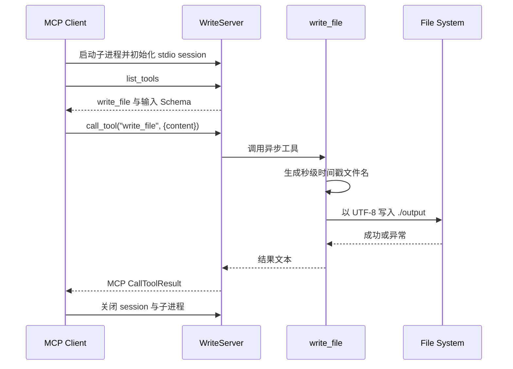
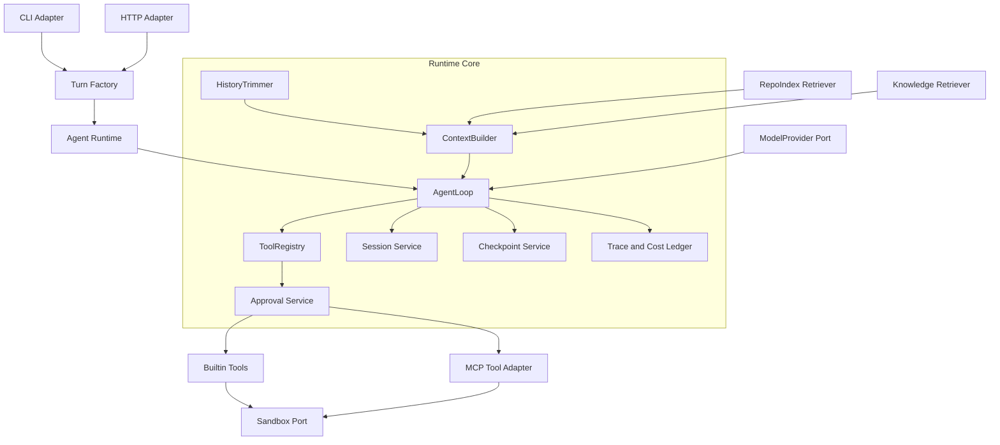

# Bale Coding Agent Harness 架构设计

## 1. 文档目的与实现状态

本文同时记录两类内容：

- **当前实现**：仓库中已经存在、可以运行和验证的 FastMCP 文件写入示例。
- **目标架构**：Coding Agent Harness 的后续设计方向，用于约束模块边界和扩展方式。

除特别注明外，带有“规划”“目标”或“后续”标识的模块均未在当前仓库实现。文档中的目标接口是逻辑契约，不代表已有 Python 类或稳定 API。

## 2. 设计目标与边界

### 2.1 目标

目标运行时围绕以下闭环组织：

```text
理解仓库 → 构建上下文 → 模型决策 → 受控工具调用 → 修改与验证
→ 有预算地诊断重试 → 输出差异、测试和追踪证据 → 支持中断恢复
```

核心原则：

1. CLI 和 HTTP 等入口只创建统一任务，不分别实现 Agent 逻辑。
2. Agent Loop、工具治理、上下文和 Checkpoint 由项目自身维护。
3. 内置工具与 MCP 工具经过同一注册、校验、审批和超时流程。
4. 不可信代码、Shell 和测试只能在明确的执行边界中运行。
5. 检索只提供证据，不代替 Agent 完成推理与验证。
6. 每次执行都应有预算、状态、错误和可追踪结果。

### 2.2 当前非目标

当前示例不提供自动代码修改、通用命令执行、多模型路由、多智能体调度、Web 前端、权限系统或生产级隔离。后续实现也应避免在缺少证据时将这些能力视为已经具备。

## 3. 当前实现架构

### 3.1 分层视图


| 层 | 当前组件 | 职责 |
|---|---|---|
| 协议入口 | `FastMCP("WriteServer")` | 注册工具并通过 `stdio` 接收 MCP 请求 |
| 工具层 | `write_file` | 接收字符串、生成文件名、执行写入并返回文本 |
| 文件适配 | `os`、`open` | 创建输出目录并以 UTF-8 写入 |
| 运行环境 | Python 进程 | 提供当前工作目录、系统时间和文件系统权限 |

当前没有独立领域层、应用服务层或持久化层。示例应保持在 `examples/`，后续运行时模块不应依赖示例中的全局配置。

### 3.2 当前模块职责

实现位于 `examples/mcp/write_server.py`：

| 组件 | 行为 | 边界 |
|---|---|---|
| `mcp` | FastMCP 服务实例 | 当前只注册一个工具 |
| `OUTPUT_DIR` | 固定为 `./output` | 相对于启动进程的工作目录 |
| `write_file(content)` | 异步 MCP 工具 | 不支持调用方指定路径 |
| 时间戳命名 | `note_YYYYMMDD_HHMMSS.txt` | 秒级精度，可能发生同秒覆盖 |
| 错误处理 | 捕获文件操作异常并返回文本 | 尚未归一化为结构化错误 |

### 3.3 当前数据流



`stdio` 同时承载协议消息，因此服务代码不应向标准输出写入普通日志。客户端应负责关闭会话并回收子进程。

## 4. 目标系统分层架构

以下为后续 Coding Agent Harness 的设计，不是当前目录结构。



| 层 | 目标职责 | 关键约束 |
|---|---|---|
| 入口适配层 | CLI、HTTP、取消和审批请求 | 入口极薄，共享同一 Turn 契约 |
| Runtime 层 | Loop、预算、状态、恢复 | 不依赖具体模型、工具或 Web 框架 |
| 上下文层 | 历史、检索、工具输出和 Token 预算 | 当前用户消息最后，数据与指令分离 |
| 工具治理层 | 注册、Schema、权限、审批、超时、错误归一化 | 所有副作用工具必须经过 Registry |
| 执行适配层 | Local、Docker 或远程 Sandbox | 隔离失败时不得静默降级到宿主执行 |
| 检索适配层 | RepoIndex 与外部知识库 | 统一返回 SearchHit，受上下文预算控制 |
| 状态与观测层 | Session、Checkpoint、Trace、Usage | 支持恢复、审计和成本核算 |

## 5. 目标模块划分

| 规划模块 | 核心职责 | 主要依赖方向 |
|---|---|---|
| `agent/turn.py` | Turn、预算、状态和入口归一化 | 仅依赖领域契约 |
| `agent/loop.py` | ReAct、终止、取消、重试预算、调用 ID | Provider、Registry、Checkpoint |
| `agent/context.py` | 稳定前缀、检索装配、TokenBudget | Retriever、History |
| `agent/history.py` | 按完整 Turn 裁剪并维持消息配对 | 领域消息模型 |
| `agent/tools/registry.py` | 注册、校验、并发、超时、错误归一化 | Tool 端口、Approval、Trace |
| `agent/tools/builtin.py` | 读写、检索、测试、Diff 等内置工具 | Sandbox、Workspace |
| `agent/tools/mcp.py` | MCP list/call、命名空间和生命周期 | MCP SDK、Registry |
| `agent/security.py` | 路径、能力、环境变量和不可信数据边界 | Workspace、Approval |
| `agent/checkpoint.py` | 独立快照、撤销、恢复和幂等 | Git、Session |
| `sandbox/` | 本地、容器和远程执行适配 | 统一 Sandbox 端口 |
| `repo_index/` | AST 切块、词法索引和行号引用 | Retriever 端口 |
| `providers/` | 模型调用、用量和离线 Fake | ModelProvider 端口 |
| `server/` | HTTP 任务、Session、审批和健康检查 | Runtime |
| `tracing/` | Span、错误、Token、延迟和成本 | 无 Runtime 反向依赖 |
| `eval/` | 固定任务、确定性验证和报告 | CLI、Workspace、Verifier |

这些路径用于说明职责边界，后续实现时应以实际代码和测试为准更新本文。

## 6. 核心逻辑契约

### 6.1 Turn

| 字段组 | 目标内容 |
|---|---|
| 身份 | `turn_id`、`session_id`、`workspace` |
| 输入 | 当前消息、可选仓库 revision |
| 预算 | 最大迭代、Token、成本、时间 |
| 权限 | 自动只读、写前审批或全部审批 |
| 状态 | created、running、waiting_approval、completed、failed、cancelled |
| 恢复 | 最近 Checkpoint、已执行调用 ID、恢复位置 |

CLI 与 HTTP 应构造同一种 Turn，避免入口行为不一致。

### 6.2 Tool 与 ToolResult

工具定义需要包含名称、JSON Schema、副作用类型、并发安全性、超时和输出限制。逻辑结果至少包含：

- `call_id`、工具名称和执行状态；
- 文本内容、结构化错误码和延迟；
- 是否截断、是否取消以及必要元数据；
- `read | write | execute` 副作用分类。

只有标记为只读且并发安全的工具可以并行执行；写入和执行工具默认串行。

### 6.3 SearchHit

检索结果统一携带内容、相似度或排序分数、来源和元数据。代码检索还应提供路径、起止行号和 revision；知识库检索可提供 chunk/document 标识。分数不能直接解释为答案置信度。

## 7. 目标核心流程

### 7.1 Turn 主流程

1. 加载 Session、工作区、能力范围和预算。
2. 装配稳定系统前缀、历史、当前任务和检索证据。
3. ModelProvider 返回助手消息或工具调用。
4. Registry 完成参数校验、权限检查、审批、幂等检查和超时控制。
5. 工具结果按不可信数据包装后进入下一轮上下文。
6. 每次迭代保存状态、追踪信息和必要 Checkpoint。
7. 无工具调用时执行任务完成判定和确定性验证。
8. 返回答案、Diff、测试结果、状态和 Trace 标识。

最大迭代、预算耗尽、取消、审批超时或不可恢复错误都不是任务成功。

### 7.2 工具治理流程

```text
查找工具 → 参数转换与 Schema 校验 → Workspace/capability 检查
→ 调用 ID 幂等检查 → 按策略审批 → 选择执行适配器
→ 超时与输出限制 → 错误归一化 → Trace → ToolResult
```

任何失败都不能退化为绕过 Registry 的宿主执行。

### 7.3 上下文与恢复

目标预算公式：

```text
available_history = context_window
                  - reserved_output
                  - reserved_tools
                  - reserved_system
                  - reserved_current
```

所有扣减后预算最小为零。超预算时先压缩检索和工具输出，再裁剪历史，最后处理长期记忆；裁剪必须维持工具调用与结果配对。恢复时只注入必要恢复块，已完成的副作用调用不得重复执行。

## 8. 技术栈选型说明

### 8.1 当前实际技术栈

| 技术 | 选择原因 | 限制 |
|---|---|---|
| Python 3.10+ | 与 MCP SDK 1.30.0 对齐 | 当前未声明更窄的解释器兼容矩阵 |
| `asyncio` | 与 MCP 异步工具模型一致 | 文件写入本身仍是本地同步操作 |
| FastMCP | 用少量代码声明工具和 Schema | 不等同于完整 Agent 工具治理 |
| MCP `stdio` | 本地进程集成简单、无需开放端口 | 客户端必须管理进程生命周期 |
| 本地文本文件 | 示例无需外部服务 | 不提供并发、权限或持久化保证 |

### 8.2 目标技术栈

| 领域 | 建议选型 | 选择理由 |
|---|---|---|
| 语言与契约 | Python 3.12、Pydantic v2 | 类型化配置、契约和异步运行时 |
| CLI / HTTP | Typer、FastAPI | 共享 Turn，分别提供本地与服务入口 |
| 模型 | OpenAI-compatible Provider、FakeProvider | 统一接口并支持离线测试 |
| 状态 | SQLite | 轻量、可恢复、低部署成本 |
| 工具协议 | 官方 MCP Python SDK | 与当前示例保持同一生态 |
| 代码检索 | Python AST、BM25 | 结构定位和确定性对照实验 |
| 隔离执行 | DockerSandbox | 非 root、无网、资源限额和清理 |
| 观测 | JSONL Trace、Usage/Cost Ledger | 无外部依赖即可审计 |
| 测试 | pytest、pytest-asyncio、ruff | 单元、契约、集成和静态检查 |

目标选型只有在相应模块和验证落地后才成为项目实际依赖。

## 9. 扩展点设计

以下接口方向用于降低实现耦合：

| 扩展点 | 调用方 | 实现方应提供的能力 |
|---|---|---|
| ModelProvider | AgentLoop | 消息与工具定义输入、结构化输出、Token 用量、取消 |
| Tool | ToolRegistry | Schema、副作用元数据、超时执行、结构化结果 |
| Sandbox | 内置工具与执行策略 | Workspace 隔离、进程控制、资源限制、清理 |
| Retriever | ContextBuilder | 按命名空间、过滤条件和 Top-K 返回 SearchHit |
| SessionStore | Session Service | append-only 消息、Turn 状态、恢复点 |
| CheckpointStore | AgentLoop | 快照、基线、撤销、调用 ID 幂等记录 |
| TraceExporter | Runtime | Span、错误、用量和成本导出 |
| Verifier | 完成任务流程 | 测试、文件、Diff 和禁止副作用检查 |

新增实现不应让 Runtime 直接依赖具体 SDK。外部 SDK 应停留在适配器内，并通过契约测试保证不同实现行为一致。

## 10. 安全与可靠性设计

### 10.1 当前示例注意事项

- 在受控目录中启动服务，并限制进程文件系统权限。
- 输出路径虽然固定，但同秒调用可能覆盖文件；重要数据不应使用该示例保存。
- MCP 客户端和服务端版本必须兼容，避免混用不同主版本的 API。
- 返回错误文本不等于结构化错误，调用方仍需检查文件是否实际生成。

### 10.2 目标运行时控制

| 风险 | 设计控制 |
|---|---|
| 路径逃逸 | canonical path、Workspace allowlist、符号链接检查 |
| 不可信命令 | Sandbox、非 root、无外部网络、资源限额和超时 |
| 密钥泄漏 | 环境变量白名单、日志脱敏、最小挂载 |
| 不可信工具内容 | 数据与指令分离、长度限制、写前审批 |
| 重复副作用 | 调用 ID、原子写、前置内容校验、Checkpoint |
| MCP 服务故障 | 服务隔离、命名空间、超时和资源清理 |

本地执行只能用于受控开发场景，不能作为不可信代码的安全边界。

## 11. 测试与验证设计

当前示例可通过 MCP 客户端执行初始化、`list_tools` 和 `call_tool`，并检查输出文件内容。后续完整运行时应分层验证：

1. **单元测试**：预算、裁剪、注册、路径、错误和状态机。
2. **契约测试**：Provider、Tool、Retriever、Sandbox、Store 的不同实现。
3. **集成测试**：MCP 生命周期、Sandbox 隔离、Checkpoint 和 Session 恢复。
4. **端到端测试**：只读理解、代码修改、失败重试、取消恢复和安全拒绝。
5. **确定性验证**：pytest 退出码、文件断言、Diff 和副作用检查。

真实外部服务不可用时，应明确标记对应测试跳过，不能以 Fake 结果代替真实集成结论。

## 12. 演进约束

- 先建立契约、Fake 和测试，再接入真实模型或执行环境。
- 优先完成最小只读闭环，再增加写入、隔离、恢复和观测。
- 每次扩展保持入口、Runtime 和 Adapter 的依赖方向不变。
- 新模块落地后同步更新实现状态、快速启动和公开接口文档。
